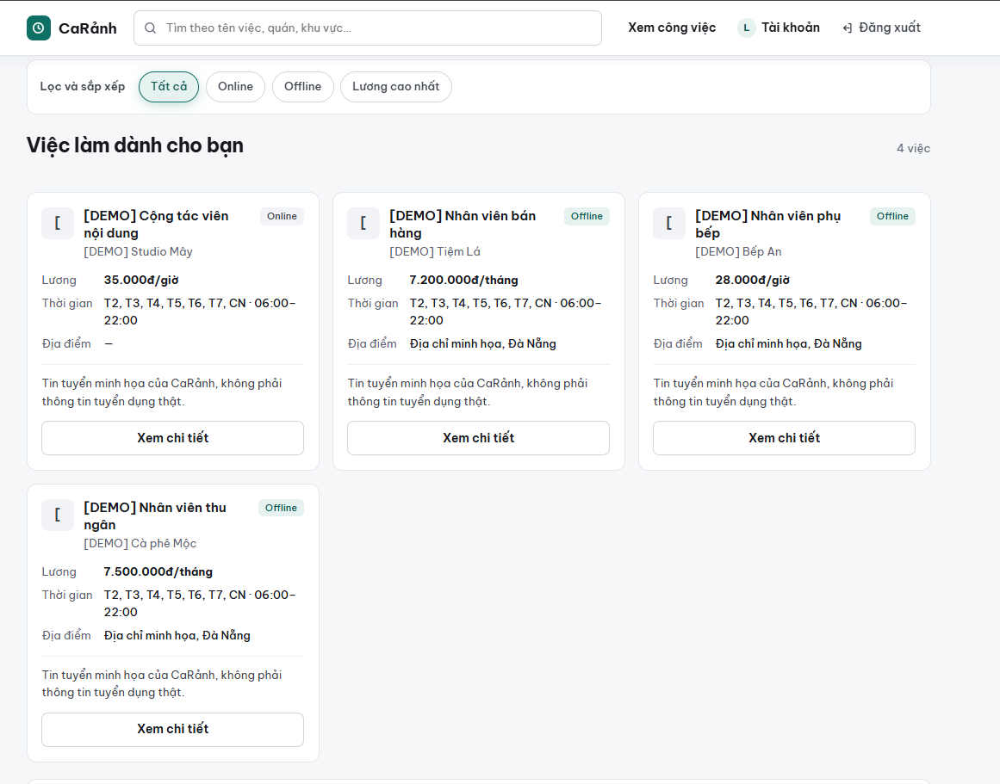
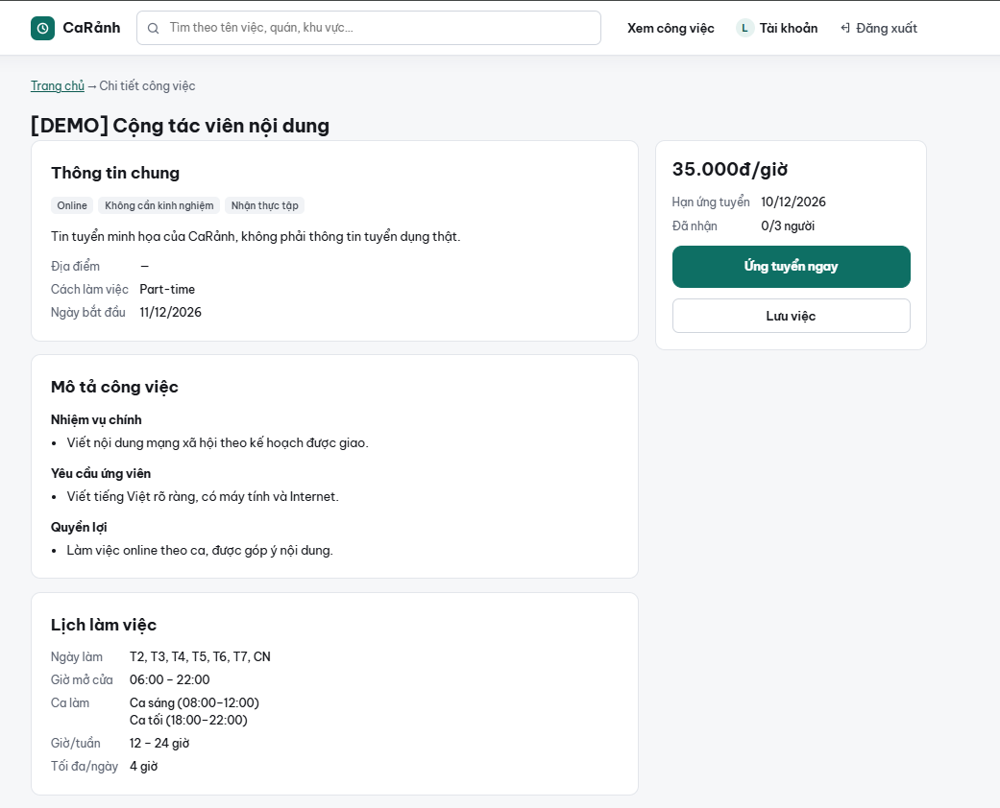
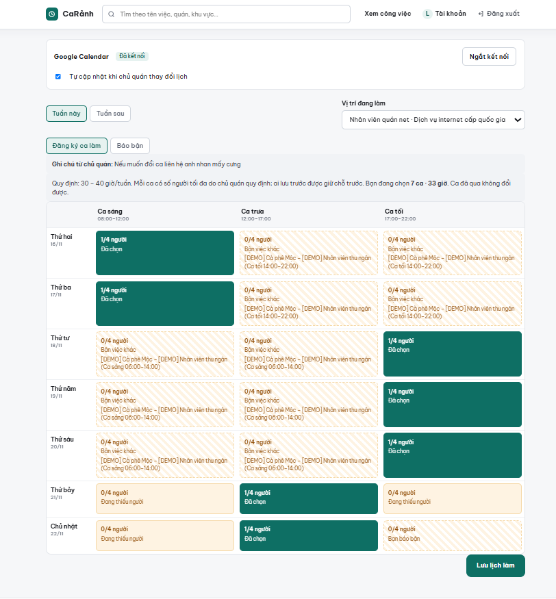
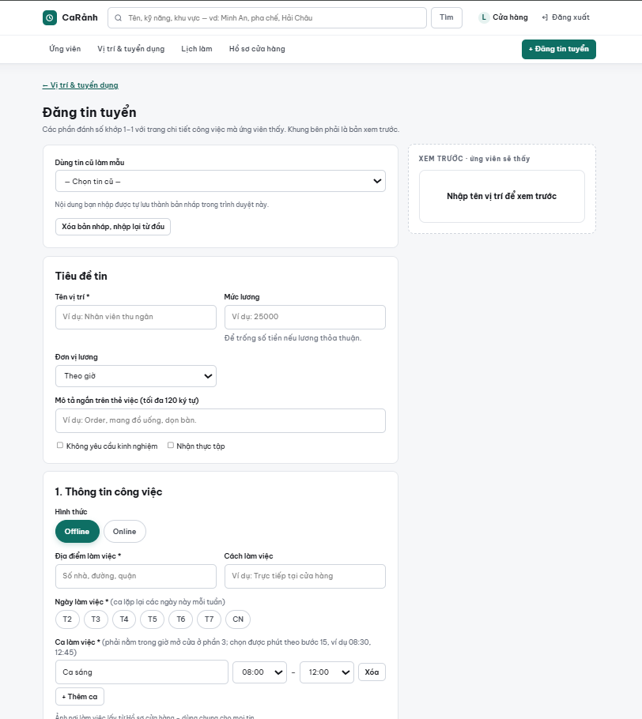
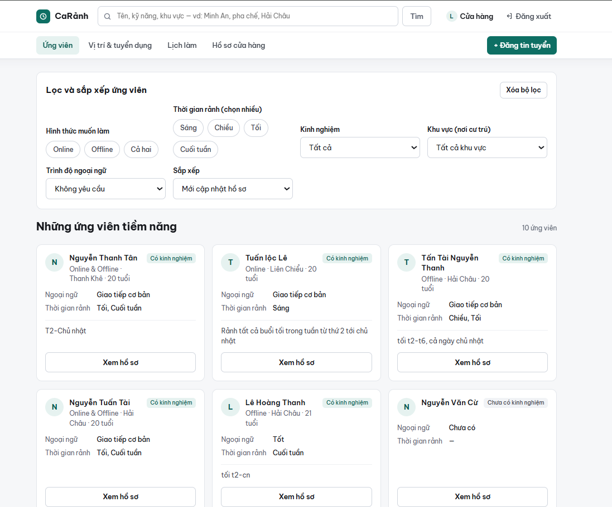
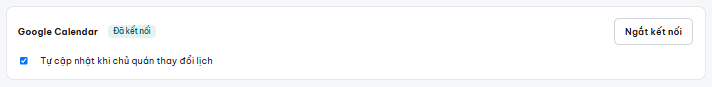
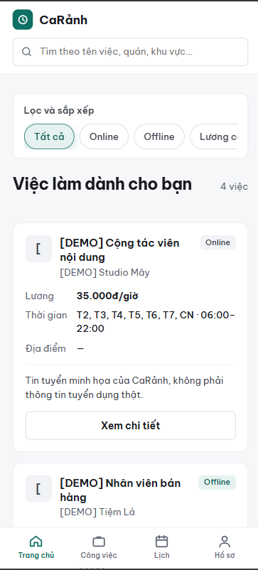
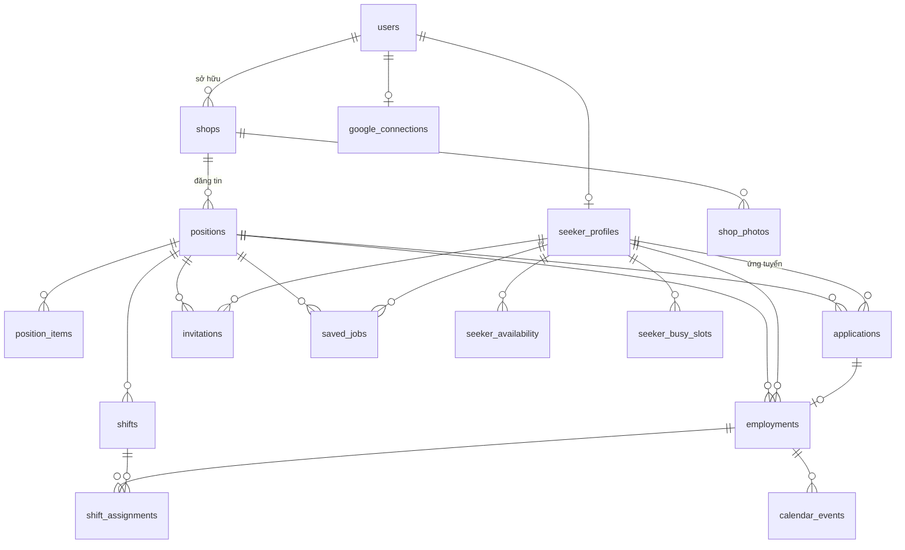

# CaRảnh – nền tảng việc làm part-time

CaRảnh kết nối **chủ quán** (đăng tin tuyển, xếp ca) với **người tìm việc** (ứng tuyển, đăng ký ca làm, đồng bộ lịch sang Google Calendar).

- **Triển khai:** https://basic-web-rho.vercel.app
- **Mã nguồn:** https://github.com/letuanlocc/basic_web
- **Video demo:** **[CẦN BỔ SUNG: link YouTube/MP4, tối đa 10 phút, tối thiểu 720p]**

## Mục lục
1. [Cách chạy ứng dụng](#1-cách-chạy-ứng-dụng)
2. [Tổng quan dự án và công cụ sử dụng](#2-tổng-quan-dự-án-và-công-cụ-sử-dụng)
3. [Tính năng và ảnh chụp màn hình](#3-tính-năng-và-ảnh-chụp-màn-hình)
4. [Sơ đồ cơ sở dữ liệu (ERD)](#4-sơ-đồ-cơ-sở-dữ-liệu-erd)
5. [Tối ưu hiệu năng, theo dõi và ghi log](#5-tối-ưu-hiệu-năng-theo-dõi-và-ghi-log)
6. [Thông tin bổ sung](#6-thông-tin-bổ-sung)

---

## 1. Cách chạy ứng dụng

**Yêu cầu:** Node.js 18 trở lên, một project Supabase (PostgreSQL). Tùy chọn: tài khoản Google Cloud (Google Calendar), Sentry, Google Analytics, Python 3 (dịch vụ NER).

```bash
git clone https://github.com/letuanlocc/basic_web.git
cd basic_web
npm install
cp .env.example .env      # rồi điền giá trị thật (xem bảng dưới)
npm run dev               # mở http://localhost:3000
```

- Nếu báo `EADDRINUSE` thì cổng 3000 đang bị chiếm.
- Kiểm tra server: `GET /api/health` trả `{ "success": true, "status": "ok" }`.
- Chạy test: `npm test`.

### Chuẩn bị cơ sở dữ liệu
1. Tạo project trên [Supabase](https://supabase.com).
2. Mở **SQL Editor** (role `postgres`) và chạy các script trong [supabase/](supabase/), thứ tự: các file trong `supabase/migrations/` theo tên (ngày), sau đó `save-schedule-exclusive.sql`, `manage-schedule.sql`, `schedule-conflicts.sql`.
3. Sơ đồ bảng xem mục [4](#4-sơ-đồ-cơ-sở-dữ-liệu-erd).

### Dữ liệu mẫu (seeder)
Script tạo dữ liệu demo nằm ở [scripts/seed-demo.js](scripts/seed-demo.js), hướng dẫn đầy đủ ở [docs/seed-data.md](docs/seed-data.md). Bộ mẫu gồm 6 tài khoản (2 người tìm việc, 4 chủ quán, email `...@caranh-demo.test`), 4 quán, 5 vị trí, 10 ca, đơn ứng tuyển, lời mời, tin đã lưu và một nhân viên có lịch. Mọi tên đều bắt đầu bằng `[DEMO]`.

```bash
# 1. Thêm vào .env một mật khẩu tự chọn (từ 12 ký tự) cho 6 tài khoản demo:
#    DEMO_SEED_PASSWORD=...
node scripts/seed-demo.js            # xem trước, không kết nối database
node scripts/seed-demo.js --apply    # thêm dữ liệu vào database
node scripts/seed-demo.js --check    # kiểm tra lại (chỉ đọc)
```

- Script chỉ **bổ sung**, không xóa hay ghi đè dữ liệu có sẵn, và chạy lại được nhiều lần.
- `--apply` ghi vào database đang cấu hình trong `.env`; script kiểm tra đúng project Supabase trước khi chạy.
- Câu truy vấn kiểm tra độc lập: [supabase/check-demo.sql](supabase/check-demo.sql). Ảnh cửa hàng mẫu: `public/demo/shops/`.
- Test offline cho script: `node --test scripts/seed-demo.test.js`.

### Biến môi trường

| Biến | Bắt buộc | Ý nghĩa |
|---|---|---|
| `PORT` | Không | Cổng server (mặc định 3000) |
| `SUPABASE_URL` | Có | URL project Supabase |
| `SUPABASE_PUBLISHABLE_KEY` | Có | Khóa công khai |
| `SUPABASE_SECRET_KEY` | Có | Khóa bí mật, **chỉ dùng ở server** |
| `SUPABASE_JWKS_URL` | Có | URL JWKS để xác minh token |
| `GOOGLE_CLIENT_ID`, `GOOGLE_CLIENT_SECRET`, `GOOGLE_REDIRECT_URI` | Khi dùng Google Calendar | OAuth Client; redirect URI dạng `https://<domain>/api/google/callback` |
| `SENTRY_DSN` | Không | Sentry cho lỗi server |
| `SENTRY_BROWSER_DSN` | Không | Sentry cho lỗi trình duyệt |
| `SENTRY_ENVIRONMENT` | Không | Tên môi trường hiển thị trên Sentry |
| `GA_MEASUREMENT_ID` | Không | Google Analytics 4, dạng `G-XXXXXXXXXX` |
| `TRUST_PROXY` | Khi chạy sau proxy (Vercel…) | Đặt `1` |
| `CORS_ORIGIN` | Không | Danh sách origin được phép, phân tách bằng dấu phẩy |
| `NER_SERVICE_URL` | Không | Địa chỉ dịch vụ NER; bỏ trống thì tìm ứng viên theo từ khóa thường |

Không bao giờ commit `.env` (đã nằm trong `.gitignore`).

---

## 2. Tổng quan dự án và công cụ sử dụng

**Bài toán:** việc làm part-time thường theo ca và đổi liên tục. CaRảnh giúp chủ quán xếp ca theo số người cần mỗi ca, giúp người tìm việc chọn ca rảnh, tránh trùng giờ giữa nhiều việc, và đưa lịch làm vào Google Calendar.

| Lớp | Công cụ |
|---|---|
| Giao diện | HTML, **Tailwind CSS 3** (class tiện ích cho bố cục) kết hợp CSS component tự viết theo design system (token trong `:root`), JavaScript thuần |
| Backend | Node.js, Express, `helmet`, `cors`, `express-rate-limit`, `compression` |
| Cơ sở dữ liệu | PostgreSQL trên Supabase (RLS, hàm RPC bằng PL/pgSQL), Supabase Auth |
| Tích hợp | Google Calendar API (`googleapis`, OAuth 2.0 + PKCE) |
| AI (tùy chọn) | PhoBERT NER (FastAPI, Python) cho thanh tìm ứng viên |
| Theo dõi và log | Sentry, Google Analytics 4, `morgan` |
| Kiểm thử | `node:test` |
| Triển khai | Vercel |
| Quản lý mã nguồn | Git, GitHub (nhánh feature, Pull Request) |
| Thiết kế | Prototype giao diện (nguồn thiết kế ghi trong [CLAUDE.md](CLAUDE.md)) |

**Cấu trúc thư mục**
```
server.js            Điểm khởi động
src/
  app.js             Cấu hình Express
  instrument.js      Khởi tạo Sentry
  config/            Client Supabase (anon / theo người dùng / admin)
  routes/            API: auth, me, positions, shifts, applications, seekers,
                     invitations, employments, google, config
  models/            Truy cập dữ liệu Supabase
  services/          Nghiệp vụ: sửa tin tuyển, Google Calendar, đồng bộ lịch
  middlewares/       Xác thực, phân quyền, validate, rate limit, xử lý lỗi
  utils/             Quy tắc vị trí, tìm ứng viên, NER, ảnh
public/              Giao diện tĩnh (20 trang .html) + css/ + js/
supabase/            Script SQL (migration, hàm RPC)
ner-service/         Dịch vụ Python NER (tùy chọn)
tests/               Test tự động
docs/                Tài liệu: ERD, hướng dẫn dữ liệu mẫu, ảnh chụp màn hình, mẫu self-report
```


---

## 3. Tính năng và ảnh chụp màn hình

**Người tìm việc**
- Đăng ký, đăng nhập, quên và đổi mật khẩu; kiểm tra trùng email và số điện thoại khi đăng ký.
- Hoàn thiện hồ sơ (ảnh, kinh nghiệm, khu vực, giờ rảnh).
- Xem, lọc, lưu tin tuyển; ứng tuyển; nhận và trả lời lời mời.
- **Đăng ký lịch làm theo tuần** (chọn ca theo ngày); hệ thống chặn ca đã đủ người và ca trùng giờ với việc khác; báo bận theo ca.
- **Đồng bộ Google Calendar** (một chiều): ca đã lưu hiện trên lịch Google đúng ngày và giờ.

**Chủ quán**
- Hồ sơ quán; đăng và sửa tin tuyển (ca làm, lương, số người mỗi ca, hạn nhận hồ sơ).
- Duyệt hồ sơ ứng viên, mời ứng viên, tìm ứng viên theo kỹ năng, khu vực, khung giờ rảnh.
- Xem và chỉnh lịch làm của từng nhân viên; xóa nhân viên khỏi danh sách.

**Ảnh chụp màn hình**

**Trang chủ, danh sách việc**



**Chi tiết công việc**



**Đăng ký lịch làm theo tuần**



**Đăng tin tuyển (chủ quán)**



**Tìm ứng viên**



**Kết nối Google Calendar** (trang Đăng ký lịch làm)



**Giao diện điện thoại** (thanh điều hướng dưới, bố cục một cột)



---

## 4. Sơ đồ cơ sở dữ liệu (ERD)

16 bảng và 1 view trên PostgreSQL. Sơ đồ đầy đủ (kèm kiểu dữ liệu từng cột) ở [docs/database-erd.md](docs/database-erd.md). Dạng rút gọn:



---

## 5. Tối ưu hiệu năng, theo dõi và ghi log

**Hiệu năng (Lighthouse)**
- Nén gzip/br cho HTML, CSS, JS, JSON (`compression`): CSS giảm từ 26,8 KB xuống 5,7 KB khi truyền.
- **Cache ở CDN:** `GET /api/positions` cho khách chưa đăng nhập được cache 30 giây (`s-maxage=30, stale-while-revalidate=120`), HTML cache 5 phút; Vercel tự xóa cache khi deploy bản mới. Yêu cầu có đăng nhập thì không cache chung.
- **Rút ngắn chuỗi tải trang chủ:** script dùng `defer`, và `<link rel="preload" as="fetch">` gọi sớm danh sách việc song song với việc tải JS, thay vì chờ JS chạy xong mới gọi API.
- **Giảm khởi động nguội (cold start) trên Vercel:** `googleapis` (240 MB) và Sentry chỉ được nạp khi thật sự dùng, nên server khởi động trong khoảng 0,6 giây thay vì 2,4 giây. Function được ghim ở vùng `hnd1` (Tokyo), cùng vùng với Supabase, qua `vercel.json`.
- **Giảm nhảy bố cục (CLS):** chừa sẵn chỗ cho header (do JS dựng) và danh sách việc; thuộc tính `hidden` luôn thắng `display` của component. Tắt header `Cross-Origin-Opener-Policy` và `Origin-Agent-Cluster` của helmet vì chúng làm Lighthouse báo lỗi `NO_NAVSTART` (không đo được Performance). Đo trên local sau khi sửa: Performance 97 đến 98, Best Practices 100, SEO 100, CLS 0,084.
- Font Be Vietnam Pro nạp bằng `<link>` kèm `preconnect` thay cho `@import` trong CSS (bỏ chuỗi tải chặn hiển thị).
- Mỗi trang có `meta description` riêng, `theme-color`, `viewport`, `lang="vi"`.
- Script theo dõi (Analytics, Sentry) chỉ nạp **sau khi trang tải xong**, không ảnh hưởng lần hiển thị đầu.
- **Kết quả Lighthouse** (trang chủ, desktop, bản trên Vercel):

| | Performance | Accessibility | Best Practices | SEO |
|---|---|---|---|---|
| Trước tối ưu, đo bằng DevTools trên máy cá nhân | 34 | 98 | 96 | 90 |
| Sau tối ưu, đo bằng DevTools trên máy cá nhân | **56** | 98 | 100 | 100 |
| Sau tối ưu, đo độc lập bằng Lighthouse CLI 12.8 (không đo bản trước) | **98** | 98 | 100 | 100 |

  Chỉ số chi tiết (Lighthouse CLI, desktop, production): FCP 0,6 s, LCP 1,1 s, TBT 0 ms, CLS 0,007, Speed Index 0,6 s. Báo cáo đầy đủ: [docs/lighthouse/production-after-desktop.html](docs/lighthouse/production-after-desktop.html) (tải về rồi mở bằng trình duyệt).

  Hai dòng DevTools đo cùng cách nên so sánh trực tiếp được (Performance 34 → 56, Best Practices 96 → 100, SEO 90 → 100). Dòng Lighthouse CLI là phép đo độc lập (3 lần liên tiếp đều 97 đến 98), không có bản "trước" để so. Chênh lệch giữa DevTools và CLI có thể do Lighthouse DevTools chạy ngay trên máy cá nhân nên chịu ảnh hưởng của CPU và tiện ích đang mở; nhóm chưa kiểm chứng điều này. Ảnh chụp báo cáo DevTools: **[CẦN BỔ SUNG]** `docs/screenshots/lighthouse-before.png`, `docs/screenshots/lighthouse-after.png`.

**Theo dõi và ghi log**
- **Sentry** (server: `src/instrument.js`; trình duyệt: nạp từ `public/js/main.js`): bắt lỗi 5xx và lỗi JavaScript. Bật bằng `SENTRY_DSN` và `SENTRY_BROWSER_DSN`. Không gửi IP, cookie hay nội dung request (`sendDefaultPii: false`). Đặt `SENTRY_TEST=1` rồi gọi `GET /api/debug-error` để tạo lỗi thử nghiệm khi demo.
- **Google Analytics 4:** bật bằng `GA_MEASUREMENT_ID`, ẩn IP (`anonymize_ip`).
- **Log truy cập:** `morgan` ghi từng request (không ghi URL callback OAuth vì chứa mã xác thực). Lỗi 500 ghi bằng `console.error`, xem trong **Vercel → Logs**.

---

## 6. Thông tin bổ sung

- **Tailwind CSS:** dùng cho bố cục và khoảng cách (flex, grid, gap, padding, cỡ chữ…) trên các trang `index`, `jobs`, `login`, `register`, `forgot-password`, `reset-password`, `overview`, thay cho `style="…"` nội tuyến (63 thẻ). Các component dùng chung (`.card`, `.btn`, `.chip`, `.sched`…) vẫn nằm trong `public/css/style.css`.
  - Cấu hình: [tailwind.config.js](tailwind.config.js). Màu, bo góc, font lấy đúng từ bộ token thiết kế; khoảng cách mặc định của Tailwind (bước 4 px) khớp thang 4·8·12·16·24·32·48.
  - Tiền tố `tw-` (ví dụ `tw-flex`, `tw-gap-4`) để không trùng tên với CSS sẵn có; tắt Preflight để không đổi giao diện hiện tại; `important` bật để class tiện ích thắng như style nội tuyến trước đây.
  - Nguồn: [tailwind/input.css](tailwind/input.css). Build ra `public/css/tailwind.css` (đã commit, vài KB sau khi loại class không dùng): `npm run build:css` (hoặc `npm run watch:css` khi đang sửa giao diện). Thêm class tiện ích mới vào HTML thì cần build lại.
- **CSDL:** dùng PostgreSQL (Supabase), không dùng MySQL. Đề bài cho phép MySQL hoặc PostgreSQL.
- **Google Calendar** ở chế độ Testing: chỉ email nằm trong *Test users* mới kết nối được, và token hết hạn sau 7 ngày. Lên production cần Google xác minh ứng dụng.
- **Bảo mật:** khóa bí mật chỉ ở server; bảng chứa token Google bật RLS và khóa quyền anon/authenticated; mọi thao tác ghi đi qua token người dùng.
- Quy ước giao diện và tiến độ tích hợp Google Calendar chi tiết: [CLAUDE.md](CLAUDE.md). Dịch vụ NER: [ner-service/README.md](ner-service/README.md).
- **Quy trình:** `main` (ổn định) ← `develop` (tích hợp) ← `feature/...`, mỗi tính năng một nhánh và một Pull Request.
