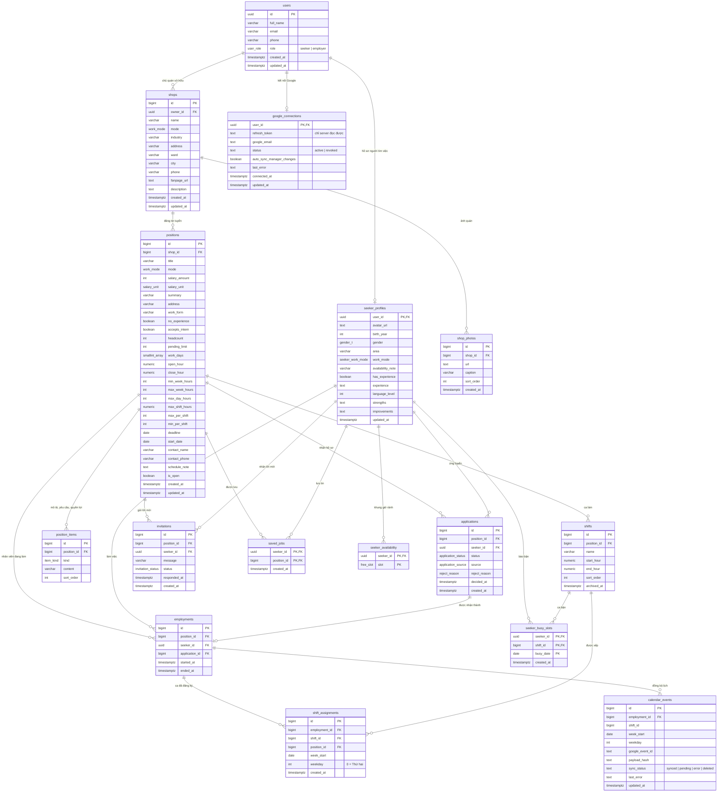

# Sơ đồ cơ sở dữ liệu (ERD)

CSDL: **PostgreSQL** do Supabase quản lý. Sơ đồ dưới đây lập từ schema thật của project (cột, kiểu dữ liệu, khóa ngoại), không phải vẽ tay.
Mermaid hiển thị trực tiếp trên GitHub.

## Giải thích nhóm bảng
| Nhóm | Bảng | Vai trò |
|---|---|---|
| Tài khoản | `users`, `seeker_profiles`, `seeker_availability` | Tài khoản dùng chung (liên kết Supabase Auth), hồ sơ và giờ rảnh của người tìm việc |
| Quán và tin tuyển | `shops`, `shop_photos`, `positions`, `position_items`, `shifts` | Chủ quán tạo quán, đăng vị trí tuyển, mỗi vị trí có nhiều ca |
| Tuyển dụng | `applications`, `invitations`, `saved_jobs` | Ứng tuyển, lời mời, lưu tin |
| Làm việc và lịch | `employments`, `shift_assignments`, `seeker_busy_slots` | Nhân viên chính thức, ca đã đăng ký theo tuần, ca báo bận |
| Google Calendar | `google_connections`, `calendar_events` | Token kết nối và ánh xạ ô lịch sang event Google |

## Ghi chú
- **View `position_overview`:** gộp `positions` với thông tin quán, số người đã nhận (`filled`), đang chờ (`pending`) và cờ `accepting`. Dùng cho trang danh sách việc.
- **Bảng bảo mật cao:** `google_connections` và `calendar_events` bật RLS, thu hồi quyền `anon`/`authenticated`, chỉ server (secret key) truy cập được.
- **Quan hệ `shift_assignments`, `seeker_busy_slots`, `calendar_events.shift_id`:** vẽ theo quan hệ logic; schema chưa khai báo khóa ngoại cho các cột này ở tầng dữ liệu.
- **Kiểu enum** (`user_role`, `work_mode`, `salary_unit`, `application_status`…) được định nghĩa trong Postgres. Giá trị cụ thể xem trong Supabase → Database → Enumerated Types.
- Script tạo và thay đổi schema: thư mục [supabase/](../supabase/) (migration theo ngày và các hàm RPC).
