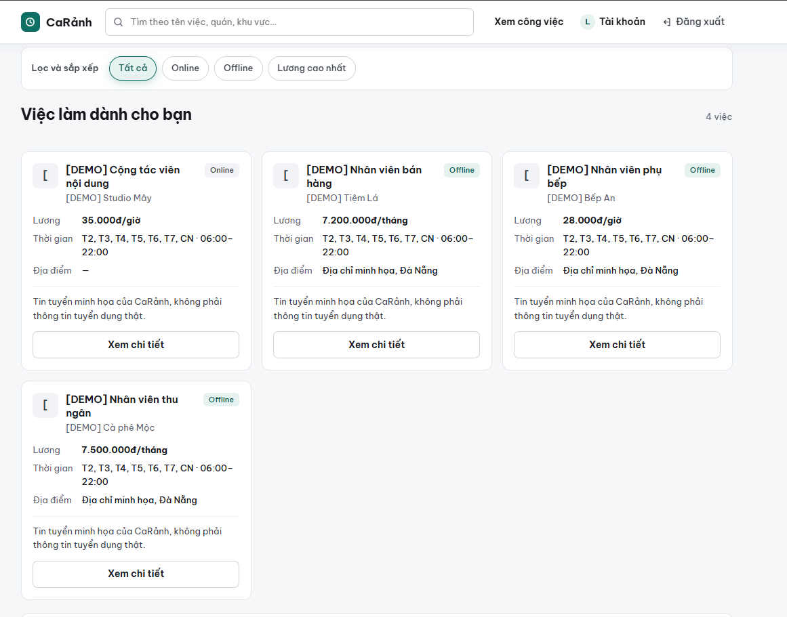
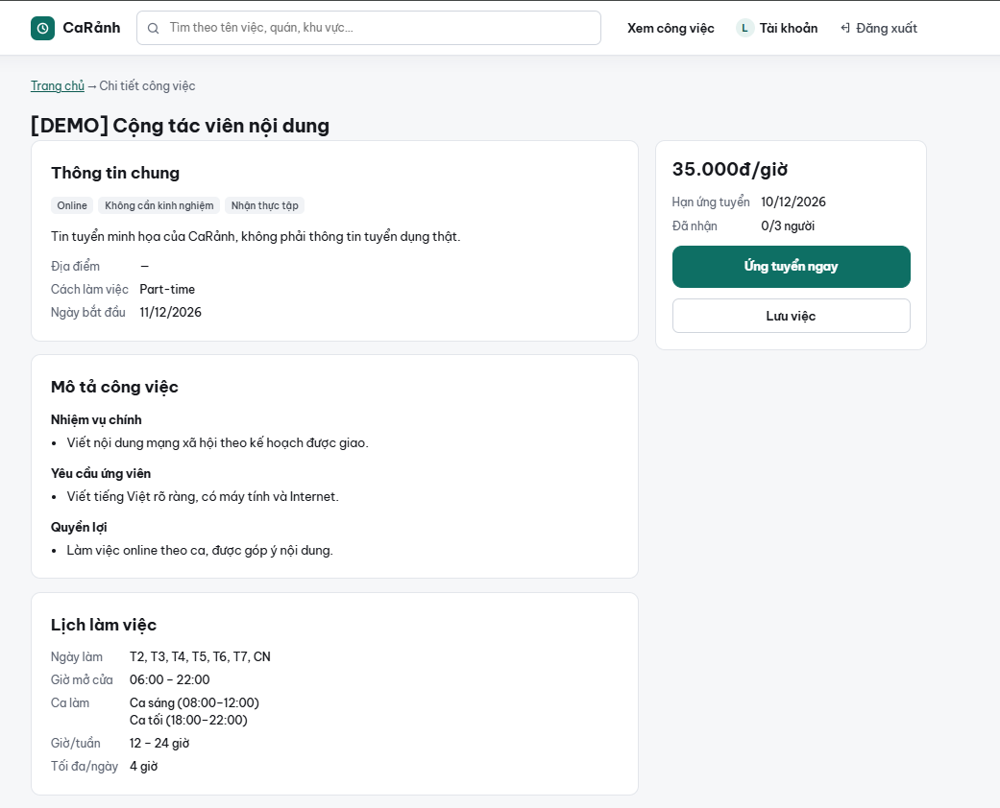
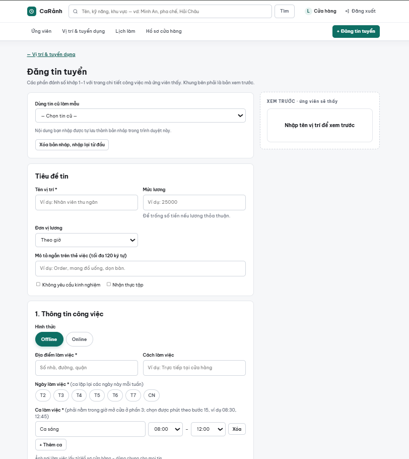
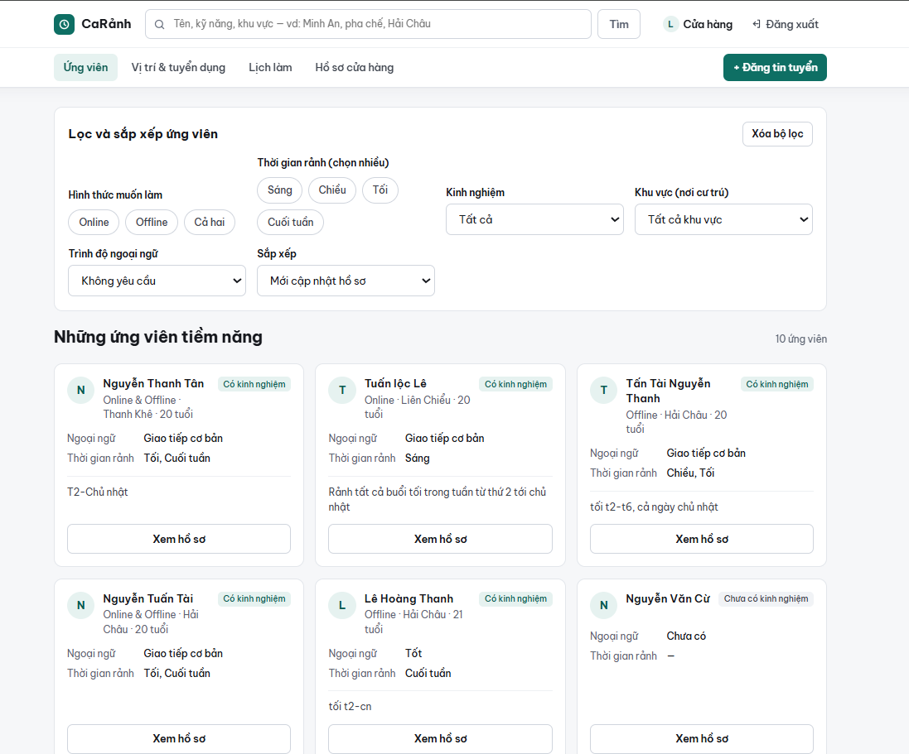
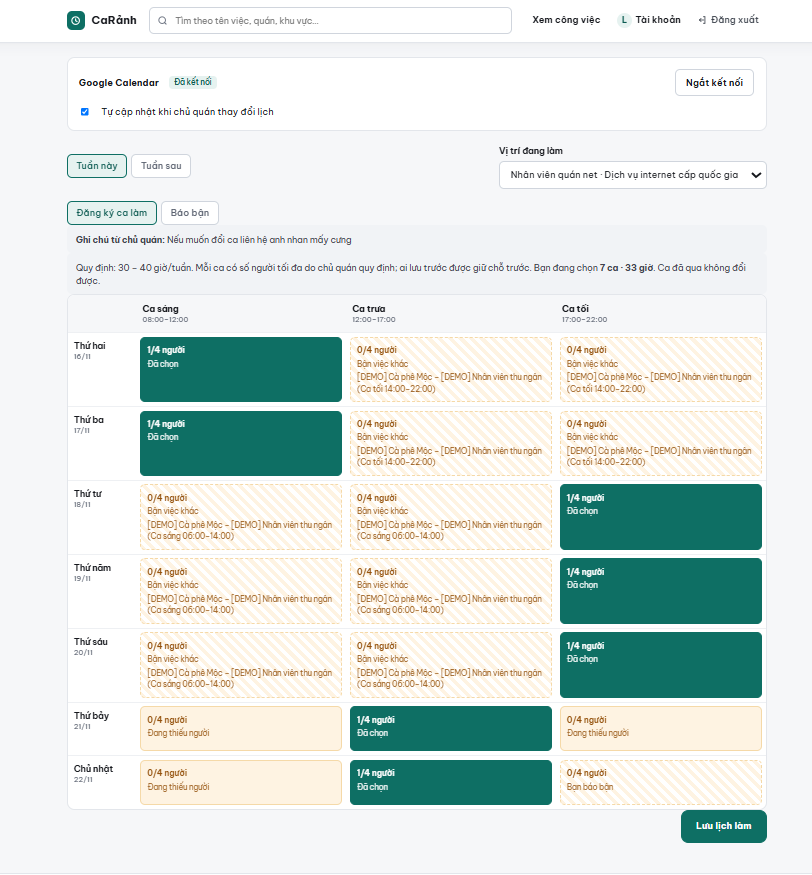
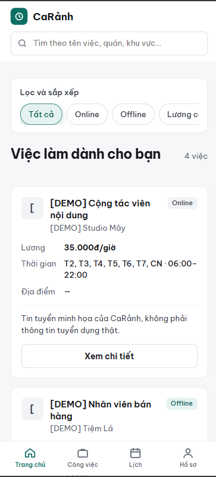

# Wireframe và thiết kế giao diện

- **Prototype gốc:** https://claude.ai/code/artifact/326c6282-8ae5-4a1d-bb3f-429e730b823c (link riêng tư, có thể không mở được với người ngoài nhóm; vì vậy ảnh chụp bên dưới là bản đối chiếu xem được trong repo).
- **Design system:** token màu/chữ/bo góc/khoảng cách ghi trong [CLAUDE.md](../CLAUDE.md) và `:root` của `public/css/style.css`.

## Ảnh giao diện các trang chính (khớp prototype)
| Trang | Ảnh |
|---|---|
| Trang chủ |  |
| Chi tiết việc |  |
| Đăng tin |  |
| Tìm ứng viên |  |
| Lịch làm |  |
| Mobile |  |

## Việc cần làm tay
- [ ] Xuất prototype thành ảnh (hoặc dán link Figma công khai) cho **đủ các trang chính** vào `docs/wireframes/`.
- [ ] Ghi buổi nhóm duyệt/chốt wireframe vào [meeting-notes.md](meeting-notes.md).
